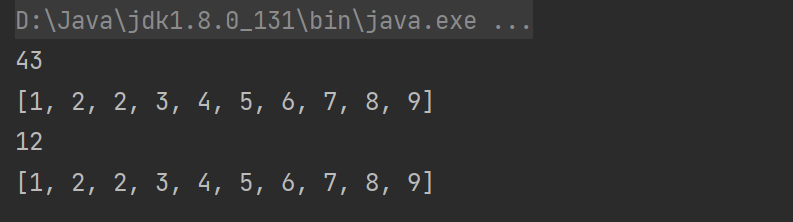

这篇笔记分两部分。前半部分是容易忘的细碎知识点：排序算法的稳定性、中缀/前缀/后缀表达式转换、哈希冲突的处理方式等。后半部分按线性表、非线性表、查找、排序的框架，结合《大话数据结构》和刷题题解整理思路。写下来主要是为了把「看得懂」变成「写得出」，所以保留了个人题解过程与心得体会。

## 目的

- 学习套路，举一反三，解决更多的问题（而不是题目）
- 培养思维，主动思考，本质思维，问题分解，抽象总结，抓大放小

## 细碎知识点

### 排序算法

稳定的排序算法：经过排序之后，原来相等的值它们的相对位置没有改变。**5**5 => **5**5

插入排序（不包括希尔排序）、冒泡排序、归并排序、基数排序，它们都是稳定的排序算法。

**插冒归基稳**

### 中缀、后缀、前缀表达式

```
(3 + 4) × 5 - 6 就是中缀表达式 
- × + 3 4 5 6 前缀表达式
3 4 + 5 × 6 - 后缀表达式
```

中缀 => 后缀：**从左到右**扫描中缀表达式，遇到符号入栈，遇到更低优先级符号，先前符号（到"("为止）出栈，遇到右括号，将匹配括号内的符号出栈。

中缀 => 前缀：**从右到左**扫描中缀表达式，遇到符号入栈，遇到更低优先级符号，先前符号（到"("为止）出栈，遇到右括号，将匹配括号内的符号出栈。

后缀计算：从左到右扫描后缀表达式，数字入栈，遇到符号弹出两个栈中数字进行计算。

前缀计算：**从右到左**扫描后缀表达式，数字入栈，遇到符号弹出两个栈中数字进行计算。

### 哈希表解决冲突的方法

1. 开放定址法
2. 再哈希法
3. 链地址法
4. 建立公共溢出区

## 《大话数据结构》

### 一种抽象思想

先定义抽象的结构与关系，比如线性表；再给出抽象的操作，比如插入、删除、查找、创建；最后针对具体的数据结构特点，比如数组、单链表、双向链表，进行具体实现。

### 对比维度

- 存储分配方式（内存存储结构）
- 时间性能（查找、删除、插入）
- 空间性能（空间浪费上）

### 线性表

逻辑上是连续的，一个接一个，可以用一条线串联起来的一种关系，一对一。不像树、图，是一对多、多对多。

#### 数组

##### 特点

- 逻辑上连续，存储上也连续，一次申请一块连续的空间，有溢出风险或者扩容的需要。

- 每个元素都有对应的索引位置，可快速查找。
- 插入与删除，需要对后续元素进行移位。
- 预分配空间存在空间的浪费，且需要考虑溢出扩容。

#### 链表

##### 特点

- 逻辑上连续，但存储上不连续，空间申请不受限，无需烦恼指定空间和扩容。
- 查找需要进行遍历，由一个查找下一个，没有索引。
- 插入与删除，只需要改变前驱与后继元素的指针域即可，无需移位。
- 每个元素需要有额外空间存放指针，占用空间更多。

##### 分类

- 单链表

- 静态链表

  用数组实现的一种链表，主要为了解决某些高级语言无指针，无法直接实现链表的问题。

  依然有存储空间上的问题，插入与删除方便

- 循环链表

- 双向链表

#### 栈

##### 特点

- 同属线性表，有特殊的约定：只能对栈顶元素进行操作（加入、删除、获取等）
- 先进后出（LIFO Last In First Out）

##### 分类

- 顺序栈
- 链栈

##### 作用

利用它的特性来解决特定的问题，而不用考虑其他因素（例如数组元素在中间插入、删除时的操作）

#####  应用

- 计算机程序，方法的递归实现
- 四则运算法的计算（中缀表达式 => 前缀表达式）

针对顺序栈，存在预分配空间的浪费，可以用栈空间共享来解决（想象：两个栈顶相对，适用于存放统一数据结构的两个栈）

顺序栈

#### 队列

##### 特点

- 同属线性表，有特殊的约定：只能对队头、队尾元素操作，从队头删除，从队尾加入
- 先进先出（FIFO First In First Out）

##### 分类

- 顺序队列
- 循环队列
- 链队列

其中，顺序队列存在队头删除后，其他元素需要移动的缺点（如果不移动，就会存在前面空间无法利用的问题）

因此有了循环队列的概念，解决了元素移动、空间无法利用的问题。

链队列则具有链表的特点，无需考虑空间分配、扩容问题，但单个元素占用空间更大。

### 非线性表

#### 树

##### 二叉树

- 前序遍历、中序遍历、后序遍历
- 满二叉树、完全二叉树
- 树与森林、与二叉树的转换
- 二叉树的性质

##### 哈夫曼树

按照权值、出现频率，重新排布成哈夫曼树，降低高频、高权值元素的层数（缩短它们的编码）达到更高效传输、遍历的效果。

典型应用：文件压缩、信息压缩，提高传输效率。

#### 图

##### 概念

- 无向图
  - 边
- 有向图
  - 弧
    - 弧头
    - 弧尾
- 完全图
- 度
  - 出度
  - 入度
- 连通
  - 连通分量
  - 强连通分量（有向图）
- 生成树
  - 有向树
  - 生成森林

##### 存储结构

- 邻接矩阵

  一维数组代表顶点，另一个二维数组代表边/弧的关系。

  缺点：

  对于稀疏图，存在很大的空间浪费，预分配空间浪费。

- 邻接表

  类似哈希表拉链法。分为顶点表和邻接表。

  顶点表得出所有顶点，邻接表跟在每个顶点后，指代顶点与其他顶点的关系。

  - 对于有向图，缺点：

    只能得到每个顶点的出度（对应邻接表） / 入度（对应逆邻接表）而无法同时得到，得到另一个需要进行遍历。

  - 对于无向图，缺点：

    每个边，是由两个顶点共享的，所以存在重复，如果需要删去一条边，需要对两个顶点进行操作。

- 十字链表

  解决有向图邻接表的缺点，十字链表既可以得到入度，也可得到出度。

- **邻接多重表**

- **边集数组**

##### 遍历算法

通用的规则：对每个访问过的元素做标记，下次不再访问。

###### DFS (Depth First Search) 深度优先算法

一个顶点，有多个边，通过其中一个，访问一个顶点，再接着这个顶点的边，访问下去...

###### BFS (Breadth First Search) 广度优先算法

一个顶点，有多个边，访问它所有的邻接点，再依次访问每个邻接点的邻接点，访问下去...

### 查找

在茫茫数据中找到想要的。

应用场景：比如，数据库查询，索引；百度、Google 搜索。

#### 有序表查询

无序化为有序，就可以有许多高效的查找算法了。

1. 二分查找
2. 插值查找
3. 斐波那契查找

#### 二分查找

实现：

```java
public static int biSearch(int[] arr, int key) {
        int low = 0;
        int high = arr.length - 1;
        while (low <= high) {
            int mid = (low + high) / 2;
            if (key < arr[mid])
                high = mid - 1;
            else if (key > arr[mid])
                low = mid + 1;
            else 
                return mid;
        }
        return -1;
    }
```

#### 插值查找

二分查找的改良版，适用于查找集合值分布均匀的情况，可提高效率。

实现：

```java
public static int insertSearch(int[] arr, int key) {
    int low = 0;
    int high = arr.length - 1;
    while (low <= high) {
        int mid = low + (int)(1.0 * (key - arr[low]) / (arr[high] - arr[low]) * (high - low));
        // 错误的计算方式：
        int mid1 = (int)(low + ((double)(key - arr[low]) / (arr[high] - arr[low]) * (high - low)));
        if (key < arr[mid])
            high = mid - 1;
        else if (key > arr[mid])
            low = mid + 1;
        else 
            return mid;
        
    }
    return -1;
}
```

#### 二叉查找树

问题：

1. 无序表查询效率低，插入、删除效率高（插入到最后、删除某个再把最后元素补上）
2. 有序表查询效率高，但插入、删除需要对元素进行移动，效率低

引出：二叉查找树

特点：

- 若左子树不为空，则所有左子树节点的值都小于根值；
- 若右子树不为空，则所有右子树节点的值都大于根值；
- 所有子树都是二叉查找树。

所以，在**查找效率**上，二叉查找树天然满足类似二分查找的特点，接近 `O(logn)`

且在**插入**上，无需移动其他元素；

在**删除**上，通过一定的算法，移动元素很少。解决了上面提到的问题。

但是仍然存在查询效率不稳定的情况，查询效率受到树的形状的影响，斜树的查询效率等同于顺序查询 `O(n)`

所以又有**二叉平衡查找树**。

##### 二叉查找树一些具体的操作

1. 查找

2. 插入

   先查找是否已有对应元素，有则加入，无则不加。

3. 删除

   删除涉及到几种情况：

   1. 删除的是叶子节点，无需对其子树进行操作；

   2. 删除的节点只有一个子节点，只需将子树接到删除节点的双亲节点上即可；

   3. 删除的节点有两个子节点，要考虑如何进行处理，可能涉及到树结构的变化。

      书中提供的解决方法是，找到删除节点它的前趋/后继节点，替换值，可以减少结构的变化。

#### 二叉平衡查找树

二叉查找树存在**斜树**的情况，导致查询效率受到树形状的影响，效率不稳定，不高。

引出二叉平衡查找树。

在满足二叉查找树性质的基础上，还需要保证**每个节点**两侧**子树的度的差值 <= 1**

##### 左旋与右旋

有其固定的操作步骤，一个简单直观的操作步骤：

```
右旋：
	A			B
   /		   / \
  B		=>	  C	  A
 /
C
左旋：
A			 	B
 \		       / \
  B		=> 	  A   C	  
   \
    C
```

代码实现详见书本内容。

#### 多路平衡查找树

为了减少硬盘 IO 而创建出了一种这样的树。

通过一篇文章可以很好了解其原理：[美团技术团队-- MySQL 索引原理及慢查询优化](https://tech.meituan.com/2014/06/30/mysql-index.html)

简单总结：

数据存在硬盘中，以“树”这种形式存储，也就是说不同节点它们存储不连续，一个节点，要读取下一个节点需要进行进一步的 IO 获取数据。

所以树的层级有多少，就需要进行多少次 IO

多路使得一个节点可以存放多个元素，使得一次 IO 可以获得多个数据，以减少 IO。

#### 哈希表

在关键字与存储位置间建立映射关系，这样的存储结构就是哈希表。

通过这种映射关系进行的查找，就是哈希查找。

特点是查找效率高，O(1)，但元素间没有联系，存在哈希冲突的问题。

##### 哈希算法(散列的算法)

##### 冲突解决

- 开放定址法（线性寻址、二次寻址、随机寻址）
- 链地址法
- 再散列法
- 公共溢出区法

### 排序

使用的场景：淘宝筛选商品，按价钱/信誉/热度排序；将搜索引擎的搜索结果以某个关键字进行排序。

排序的稳定性：排序时，不改变相等元素的次序的排序，称为稳定排序。

不稳定的排序，如果是由单一关键字单次排序，不会有影响。但如果按照多个关键字排序，有先后顺序，那不稳定排序会破坏先前的排序结果。举例：数据库 order by field1, filed2 如果不稳定，就会影响结果，破坏前面 filed1 的排序。

#### 简单排序

##### 冒泡排序

将数组逆时针旋转 90°，排序的过程就像气泡向上漂浮的过程。

最简单的排序之一。

时间复杂度 O(n^2^)

**回想一个面试官的问题：冒泡排序，它的本质是什么？**

当时的回答是：排序啊。

现在我可以说得更具体：本质就是从第一个元素开始，将它与后一个元素比较，如果它大，则交换顺序，再将第二个元素和第三个元素比较...循环这个步骤。

这个过程有个特点，如果交换了，则下次依然用上次的元素与下一个进行交换。

比如 `{3,2,1}` 经过一次交换得到 `{2,3,1}` 下次仍然是用 3 和 下一个元素 1 进行比较。

也就是说，如果最大的元素进行了交换，那么意味着下次依然用它进行交换，一直把它排到数组最后的位置。

所以，每次 “冒泡” 的过程，就是确定最后一个位置，找到最大元素的过程，也就是让最大元素 “冒泡” 的过程。

第一次确定第一大的元素，第二次确定第二大的元素，就这样元素按从大到小依次 “冒泡”，找到了自己的位置。这就是冒泡排序的过程。

当然这中途可能会有次大元素先冒泡，找到最大元素之后，换成是最大元素进行冒泡的情况。但基本的思想就是如上所述。

**其实和简单选择排序的思想有点类似：**每次确定最大的元素，第二次确定第二大的元素。**但冒泡排序多了很多交换的步骤**。

```java
public static int[] bubbleSort(int[] arr) {
    int[] ints = Arrays.copyOf(arr, arr.length);
    boolean flag = true;
    for (int i = 0; i < ints.length - 1 && flag; i++) {//flag保证一旦已经有序，就不再进行排序
        flag = false;
        for (int j = 0; j < ints.length - 1 - i; j++) {
            if (ints[j] > ints[j + 1]) {
                swap(ints, j, j + 1);
                flag = true;
            }
        }
    }
    return ints;
}
```

##### 简单选择排序

从第一个元素开始，每次确定一个位置的元素（是最大 or 最小）将原来的元素和那个最小的元素交换进行交换，这样渐渐确定每个位置存放什么元素。（选择最大/最小元素进行交换）

```java
public static int[] selectSort(int[] arr) {
    int[] ints = Arrays.copyOf(arr, arr.length);
    for (int i = 0; i < ints.length - 1; i++) {
        int min = i;
        for (int j = i + 1; j < ints.length; j++) {
            if (ints[j] < ints[min]) {
                min = j;
            }
        }
        if (min != i) {
            swap(ints, i, min);
        }
    }
    return ints;
}
```

##### 直接插入排序

从数组的第二个元素开始，将前面元素视为有序表，比较这个元素和前一个元素的大小，如果小于前一个，则需要插入到前面的有序表中；如果大于，则对下一个元素进行同样操作过程。

```java
public static int[] insertSort(int[] arr){
    int[] ints = Arrays.copyOf(arr, arr.length);
    for (int i = 1; i < ints.length; i++) {
        if (ints[i] < ints[i - 1]){
            int temp = ints[i];
            int j;
            //j >= 0 和 && 都很重要，防止数组越界
            for (j = i - 1; j >= 0 && ints[j] > temp; j--) { 
                ints[j + 1] = ints[j];
            }
            ints[j + 1] = temp;
        }
    }
    return ints;
}
```

#### 改进排序

##### 希尔排序

直接插入排序的升级版。

先将无序表转为基本有序表，最后用直接插入来将基本有序表转为有序表。

控制每次交换元素之间的距离/步长，最后变为 1

时间复杂度突破了 O(n^2^)，属于高级排序算法

**为什么它的效率相比直接插入排序有所提高呢？**

因为它把一个数组拆分成很多小数组，每个小数组进行直接插入排序（元素少意味着元素移动少）形成一个基本有序的数组，再进行直接插入排序（意味着元素移动次数少）

直接插入排序对于小数组和基本有序数组的效率是很高的，接近 O(n)

对比一个排序的效果

```java
int[] arr2 = {9, 8, 7, 6, 5, 4, 3, 2, 1, 2};
//记录对这个数组排序时元素移动的次数
System.out.println(Arrays.toString(insertSort(arr2)));
System.out.println(Arrays.toString(shellSort(arr2)));
```

结果差距显著：

 

实现：

```java
public static int[] shellSort(int[] arr) {
    int[] ints = Arrays.copyOf(arr, arr.length);
    int increment = ints.length;
    do {
        int temp;
        increment = increment / 3 + 1;
        for (int i = increment; i < ints.length; i++) {
            if (ints[i] < ints[i - increment]) {
                temp = ints[i];
                int j;
                //j >= 0 和 && 都很重要，防止数组越界
                for (j = i - increment; j >= 0 && ints[j] > temp; j -= increment) { 
                    ints[j + increment] = ints[j];
                }
                ints[j + increment] = temp;
            }
        }
    } while (increment > 1);
    return ints;
}
```

##### 堆排序

利用堆结构进行的一种改进排序算法。

堆结构：

1. 大顶堆

   - 满足完全二叉树的性质

   - 根节点大于左右的子节点
   - 每个子节点同样满足这个性质

   所以大顶堆的根节点最大。

2. 小顶堆

   与大顶堆相反，根节点最小。

因为满足完全二叉树的性质，所以很容易得到父子节点之间的关系，左子节点序号 = 父节点序号 * 2 ，右子节点序号 = 父节点序号 * 2 + 1，知道这个性质就能够方便进行堆结构的构建与调整，进行元素访问。

```java
/**
 * 堆排序
 */
public static int[] heapSort(int[] arr) {
    int[] ints = Arrays.copyOf(arr, arr.length);
    //先把所有非叶子节点调整为大顶堆
    for (int i = ints.length / 2; i > 0; i--) {
        heapAdjust(ints, i, ints.length);
    }
    //再调整数组的次序，最大的元素放后边（把堆顶的元素和最后一个元素交换位置），每次调整之后，再重构大顶堆
    for (int i = ints.length - 1; i > 0; i--) {
        swap(ints, 0, i);
        heapAdjust(ints, 1, i);
    }
    return ints;
}

/**
 * 调整堆结构，以 s 位置元素为根，调整该根节点满足大顶堆性质
 * 前提：(s, m] 各元素都满足堆的条件
 * 完全二叉树的性质索引从 1 开始，这里数组从 0 开始存储，所以下面对元素的访问，对应的索引都 - 1
 */
private static void heapAdjust(int[] arr, int s, int m) {
    int temp = arr[s - 1];
    for (int i = 2 * s; i <= m; i *= 2) {
        if (i < m && arr[i - 1] < arr[i]) {
            i++;
        }
        if (temp > arr[i - 1]) {
            break;
        }
        arr[s - 1] = arr[i - 1];
        s = i;
    }
    arr[s - 1] = temp;
}
```

##### 归并排序

> “归并”一词的中文含义就是合并、并入的意思，而在数据结构中的定义是将两个或两个以上的有序表组合成一个新的有序表。

1. 递归方式

   实现：

   ```java
   public static int[] mergeSort(int[] arr) {//为保证传递一个数组参数，进行方法进一步封装
       mergeSort0(arr, arr, 0, arr.length - 1);//实际排序方法
       return arr;
   }
   
   private static void mergeSort0(int[] arr, int[] distArr, int s, int k) {
       if (s == k) {
           distArr[s] = arr[s];
           return;
       }
       int[] newArr = new int[arr.length];
       int m = (s + k) / 2;
       mergeSort0(arr, newArr, s, m);//前半部分操作，相当于前半部分进行归并有序化
       mergeSort0(arr, newArr, m + 1, k);//后半部分操作，相当于前半部分进行归并有序化
       merge(newArr, distArr, s, m, k);//合并前半部分和后半部分，使其有序
   }
   
   //合并两个有序数组
   private static void merge(int[] arr, int[] distArr, int s, int m, int k) {
       int i, j, n;
       for (i = m + 1, j = s; s <= m && i <= k; j++) {
           if (arr[s] < arr[i])
               distArr[j] = arr[s++];
           else
               distArr[j] = arr[i++];
       }
       if (i <= k) {
           for (n = 0; n <= k - i; n++)
               distArr[j + n] = arr[i + n];
       }
       if (s <= m) {
           for (n = 0; n <= m - s; n++)
               distArr[j + n] = arr[s + n];
       }
   }
   ```

2. 非递归方式

   将递归方式改为迭代，转为操作数组索引。先是两两合并，再 4-4 合并，再 8-8 合并...操作对应的索引范围，进行合并。

   避免递归，效率更高。

   实现：

   ```java
   public static int[] mergeSort2(int[] arr) {
       int[] tempArr = new int[arr.length];
       int k = 1;
   
       while (k < arr.length) {
           mergePass(arr, tempArr, k, arr.length - 1);
           k *= 2;
           mergePass(tempArr, arr, k, arr.length - 1);
           k *= 2;
       }
       return arr;
   }
   
   private static void mergePass(int[] arr, int[] distArr, int s, int n) {
       int i = 0;
   
       while (i <= n - 2 * s + 1) {
           merge(arr, distArr, i, i + s - 1, i + 2 * s - 1);
           i += 2 * s;
       }
   
       if (i < n - s + 1) {
           merge(arr, distArr, i, i + s - 1, n);
       } else {
           if (n + 1 - i >= 0) System.arraycopy(arr, i, distArr, i, n + 1 - i);
       }
   }
   ```

##### 快速排序

选定一个枢轴，并将它移动到对应位置，满足左边元素不大于它，右边元素不小于它，再对左侧、右侧数组进行同样操作。

用到双指针的技巧。

实现：

```java
public static int[] quickSort(int[] arr) {
        qSort(arr, 0, arr.length - 1);
        return arr;
    }

    private static void qSort(int[] arr, int low, int high) {
        int pivot;
		//普通的递归方式
//        if (low < high) {
//            pivot = partition(arr, low, high);
//
//            qSort(arr, low, pivot - 1);
//            qSort(arr, pivot + 1, high);
//        }

        //尾递归?存疑，通过迭代而非递归的方式减少递归深度，提高性能，减少方法栈深度
        while (low < high){
            pivot = partition(arr, low, high);

            qSort(arr, low, pivot - 1);
            low = pivot + 1;
        }
    }

    private static int partition(int[] arr, int low, int high) {
        int pivotKey = arr[low];//假设枢轴为 arr[low]，并把它移动到相应的位置

        while (low < high) {
            while (low < high && arr[high] >= pivotKey)
                high--;
            swap(arr, low, high);
            while (low < high && arr[low] <= pivotKey)
                low++;
            swap(arr, low, high);
        }
        return low;
    }
```

## 算法秘籍

### 数组

#### 双指针

##### 快慢指针

1. **解决数组/链表原地删除问题**

   本质：一个指针用来遍历老数组，一个指针用来维护新的数组（在老数组中）

   1. [删除有序数组中的重复项](https://leetcode.cn/problems/remove-duplicates-from-sorted-array/)

      [labuladong 题解](https://labuladong.github.io/algo/2/20/23/)
   
   2. [删除排序链表中的重复元素](https://leetcode.cn/problems/remove-duplicates-from-sorted-list/)
   
      相同的逻辑，操作链表
   
   3. [移除元素](https://leetcode.cn/problems/remove-element/)
   
   4. [移动零](https://leetcode.cn/problems/move-zeroes/)
   

##### 左右指针

1. 二分查找

2. [两数之和 II](https://leetcode.cn/problems/two-sum-ii-input-array-is-sorted/) 有序数组两数之和 

   [一张图告诉你 O(n) 的双指针解法的本质原理--搜索空间](https://leetcode.cn/problems/two-sum-ii-input-array-is-sorted/solutions/87919/yi-zhang-tu-gao-su-ni-on-de-shuang-zhi-zhen-jie-fa/)

3. [反转字符串](https://leetcode.cn/problems/reverse-string/)

4. 回文串判断

5. [最长回文子串](https://leetcode.cn/problems/longest-palindromic-substring/) 中心拓展

#### 前缀和数组

前缀和 —— 即数组的索引代表之前索引元素之和。用于快速、频繁计算某个索引区间的元素之和。**典型的空间换时间算法**。

1. [区域和检索 - 数组不可变](https://leetcode.cn/problems/range-sum-query-immutable/description/)
   - 关键在于数组初始化只有一次，和检索的方法会调用很多次。因此在初始化的时候完成一些工作将大大提升整体效率。
   - 空间换时间。初始化时维护一个 i 位置存储前 i - 1 元素和的这样一个数组，这样在后续得到区间和的时候只需访问两次该数组即可。时间复杂度达到 O(1)，免去每次求解都要遍历数组的繁琐，时间复杂度为 O(n)。
2. [二维区域和检索 - 矩阵不可变](https://leetcode.cn/problems/range-sum-query-2d-immutable/description/)
   - 同样，二维数组初始化一次，可以维护一个前缀和二维数组，用来存储之前元素之和。
   - 这里可以使用与一位数组一样的存储思路，每行都是一个前缀和数组，但计算总和的时候仍然需要遍历一个索引范围，效率不是最优。
   - 维护一个 (i,j) 位置存储从 (0,0) 到 (i-1, j-1) 所有元素之和的矩阵，可通过关系，访问 4 次该矩阵就可得到任意矩形子元素。

#### 差分数组

差分数组，维护一个存储原数组相邻元素差值的数组。用于频繁对数组多个区间进行增减。

题目都是典型的有二维数组，里面存储着三元组，包括起始位置，终止位置和要增减的数值。

```java
/*
差分数组：
    diff[0] = array[0];
    diff[i] = array[i] - array[i - 1];
    i >= 1
*/

//差分数组修改，对应原数组某区间的增减。可见只需修改两个位置的值，效率大大提升。
private void update(int[] diff, int begin, int end, int incNum){
        diff[begin] += incNum;
        if(end + 1 < diff.length)
            diff[end + 1] -= incNum;
    }
//由差分数组获得原始数组
private int[] getRes(int[] diff){
    int[] res = new int[diff.length];
    res[0] = diff[0];
    for(int i = 1; i < res.length; i++){
        res[i] = diff[i] + res[i - 1];
    }
    return res;
}
```

1. [区间加法](https://leetcode.cn/problems/range-addition/description/)

   经典

2. [航班预订统计](https://leetcode.cn/problems/corporate-flight-bookings/description/)

   变型。对上题进行了一次包装，本质相同。编号从 1 开始，所以处理时 -1

3. [拼车](https://leetcode.cn/problems/car-pooling/description/)

   变型的变型。重点在 to 位置下车，人数需要变动。与之前思路不同

#### 二分查找

##### 细节

值得注意的细节点：

- `while()` 里是 `<=` 还是 `==` ?

  `<=` 针对初始化时 `right = nums.length` 的情况，`==` 针对 `right = nums.length - 1` 的情况，同时这里也可以用到**搜索空间/区间**的思路，左闭右开[)对应上述前者，两端都闭[]对应后者。

- mid + 1? mid - 1? mid?

  **根据左闭右开还是两端都闭来看。**如果两端都闭，搜索空间刚开始是 `[l,r]`，经过一次搜索，将改变 `l` 或 `r`，因为能取到两端，所以 `l = mid + 1; r = mid - 1;`

  如果左闭右开，`[l,r)`，每次搜索不包括 `r`，所以 `r = mid`

- 返回值，增设 `res` 存储结果能够免去最后越界的判断。

1. [二分查找](https://leetcode.cn/problems/binary-search/description/)

   基本的二分查找

   ```java
   public int search(int[] nums, int target) {
       int left = 0, right = nums.length;
       while (left < right){
           int mid = left + (right - left) / 2;
           if (nums[mid] == target)
               return mid;
           else if (nums[mid] > target)
               right = mid;
           else if (nums[mid] < target)
               left = mid + 1;
       }
       return -1;
   }
   ```

2. [在排序数组中查找元素的第一个和最后一个位置](https://leetcode.cn/problems/find-first-and-last-position-of-element-in-sorted-array/description/)

   寻找左侧边界与右侧边界

   ```java
   public int[] searchLeftRange(int[] nums, int target) {
       int left = 0, right = nums.length;
       while(left < right){
           int mid = left + (right - left) / 2;
           if (nums[mid] == target){
               right = mid; //向左侧边界靠拢，-1 是因为左闭右开
           } else if (nums[mid] < target){
               left = mid + 1;
           } else if (nums[mid] > target){
               right = mid;
           }
       }
       return left;
   }
   ```

##### 应用

将二分查找的方法、思维应用到具体的问题上。

总结特点：

1. `x` 与 `f(x)` 的关系

   拿最基本的二分查找实现来说，`x` 对应数组索引，`f(x)` 对应索引位置的值，形成函数关系，并且是非单调递增/递减的。

2. `f(x)` 有一个 `target` 值

   通过比较各 `x` 位置 `f(x)` 与 `target` 的关系，改变 `left` 和 `right` 的大小。

3. 寻找 `x` 的取值范围，即确定 `left` 和 `right` 的值，搜索区间的范围

4. 套用上面总结的细节框架，使用二分查找解决问题

题目：

1. [爱吃香蕉的珂珂](https://leetcode.cn/problems/koko-eating-bananas/)

   - 吃香蕉速度为 x，吃完香蕉所需的时间为 f(x)，target 为时间限制 h，套用模板。

   - 注意如果使用结果变量 res 需要注意，不仅仅需要在 == target 时改变 res，这是比较麻烦的一点。

2. [在 D 天内送达包裹的能力](https://leetcode.cn/problems/capacity-to-ship-packages-within-d-days/description/)

   - 最大运载量为 x，送完包裹需要的时间为 f(x)，target 为 D 天时间限制，套用模板。

3. [分割数组的最大值](https://leetcode.cn/problems/split-array-largest-sum/description/)

   - 识别这个问题，本质和上一题一模一样。

#### 田忌赛马

### 链表

#### 链表合并

1. [合并两个有序链表](https://leetcode.cn/problems/merge-two-sorted-lists/)

   **迭代方式**。此外有递归方式，占用更多栈空间。

   - 使用**虚拟头结点**，头结点不放置元素值，下一个元素是真正的链表元素。

     这样可以将首元素的赋值操作和后面的循环操作合并，并且一旦没有了首元素赋值，也就不需要进行判空操作（由后续完成）大大简化了代码。

   - 可直接改变原链表结构，无需新建节点元素。

     刚开始的顾虑就在于，害怕改变了原有的链表结构后影响链表正常遍历，但事实上没有影响到遍历，因为改变 `next` 的时候虽然无法通过它得到原来的下一个元素，但还存在 `point` 指针指向下一个（改变 `next` 的同时，会将 `point` 指向下一个，而不会丢失后续链表），所以无需担心。

2. [合并 k 个有序链表](https://leetcode.cn/problems/merge-k-sorted-lists/)

   假设 k 个链表，共 N 个元素

   - **自己实现的方式**：每次读取 k 个链表首元素，得到最小元素，加入到新链表后。此算法时间复杂度为**`O(kN)`**

   - **labuladong 进阶方式**：使用优先队列**`PriorityQueue`**自带的小顶堆结构，来获取最小元素，每次加入这个最小元素到新链表后。此算法时间复杂度为**`O(Nlogk)`**

   - 使用合并两个有序链表，依次合并。链表共合并 k^2^ / 2 次，每个链表平均长度 N / k ，所以时间复杂度为**`O(kN / 2)`**

   - **另外的进阶思路**：本质就是归并排序，两两合并，平均每个链表合并 logk 次，共合并 k * logk 次，每个链表平均长度 N / k 时间复杂度也是**`O(Nlogk)`** **和归并排序使用到了同样的思想思路** 效率最高

     [leetcode 题解](https://leetcode.cn/problems/merge-k-sorted-lists/solutions/220518/4-chong-fang-fa-xiang-jie-bi-xu-miao-dong-by-sweet/)

#### 链表分解

1. [分隔链表](https://leetcode.cn/problems/partition-list/)
   - 同样使用**虚拟头结点**，统一了头元素和后续元素操作，并到循环中，简化代码
   - 构造完成两个区域，结尾元素`next`置`null`防止成环
   - 最后连接两个区域（左指针指向右侧首元素即可，无需判断右侧区域是否为空）

#### 单链表倒数第 N 个结点

1. [删除链表的倒数第 N 个结点](https://leetcode.cn/problems/remove-nth-node-from-end-of-list/description/)

   - 分解问题，先能找到倒数第 N 个结点，再进行删除
   - 虚拟头结点，统一第一个元素和后续元素的删除操作

   技巧的巧妙之处在于**一次遍历找到第 N 个结点**：

   第一个指针走 N 步，设置第二个指针指向头结点，两指针同步走直到第一个指针遍历完成，此时第二个指针指向第 K - N + 1 个结点的位置，也就是倒数第 N 个元素了。

#### 单链表的中点

1. [链表的中间结点](https://leetcode.cn/problems/middle-of-the-linked-list/description/)

   快慢指针，快指针走两步，慢指针走一步

   - `p.next.next`的方式
   - `count % 2 == 0`的方式

   第一种更简洁，但第一次不敢用

#### 链表是否成环

类似链表中点的快慢指针，如果两个指针可以相遇，就代表成环；如果`fast`遇到空指针则代表无环。

**进阶：寻找链表环起点**

类似于倒数第 N 个结点，使用到了**巧妙的数学关系**

同样的成环逻辑，同样的快慢指针。不同的是当确定有环，也就是`slow`和`fast`相遇后，将`slow`重新指向头结点，`fast`和`slow`同步前进，最后相遇的地方就是环的起点。

**分析原理：**

假设相遇时，`slow`走了 k 步，那么`fast`走了 2k 步。它们相遇了（此时它们一定都在环中），代表`fast`比`slow`多走了整数圈，也就是 k 步就是整数圈。

假设相遇点距离起点距离为 m，则头结点距离相遇点距离为 k - m；

而`fast`从相遇点开始走 k 步，有到达相遇点，那么少走 m 步，也就是走 k - m 步，同样也到达了环起点。

#### 链表交点

1. [相交链表](https://leetcode.cn/problems/intersection-of-two-linked-lists/description/)
   - 首尾相连的思路，让两个链表总长度相同；让链表成环；
   - `while(pA != pB)`这种操作来做相等判定，免去了使用`if(pA == pB) return pA;`判定，简化了代码。

### 题解

#### 1. 两数之和

链接：https://leetcode.cn/problems/two-sum/

##### 初始代码

```java
class Solution {
    public int[] twoSum(int[] nums, int target) {
        for(int i = 0; i < nums.length - 1; i++){
            for(int j = i + 1; j < nums.length; j++){
                if(nums[i] + nums[j] == target){
                	return new int[]{i, j};
                }
            }
        }
        return null;
    }
}
```

##### labuladong 思路

两数之和的两种常见思路：

1. 数组排序后，使用双指针

   **问题**

   1. 为什么需要排序？

   2. 为什么在有序数组上使用双指针就正确了？

   **解答：**

   [一张图告诉你 O(n) 的双指针解法的本质原理--搜索空间](https://leetcode.cn/problems/two-sum-ii-input-array-is-sorted/solutions/87919/yi-zhang-tu-gao-su-ni-on-de-shuang-zhi-zhen-jie-fa/)

   实现：

   ```java
   public int[] twoSum(int[] numbers, int target) {
       int left = 0, right = numbers.length - 1;
       while (right > left){
           int res = numbers[right] + numbers[left];
           if (res == target){
               return new int[]{left + 1, right + 1};
           } else if (res > target){
               right--;
           } else if (res < target){
               left++;
           }
       }
       return null;
   }
   ```

2. 使用 Hash 表，建立 **值 => 索引** 的映射关系 

   因为知道一个元素 `nums[i]` 的值和索引之后，再知道是否有一个值等于 `target - nums[i]` ，再得到它的索引即可。

   所以思路就是，将数组元素的值为 key，索引为 value 存储到 HashMap 中。

   一次遍历数组，将每个元素存储到 HashMap 中，并对每个元素做出上面所说的判断，即 是否有一个值等于 `target - nums[i]` ，这里直接用到 HashMap 中 `containsKey` 方法，如果存在，返回结果。

   代码如下：

   ```java
   class Solution {
       public int[] twoSum(int[] nums, int target) {
           // 维护 val -> index 的映射
           HashMap<Integer, Integer> valToIndex = new HashMap<>();
           for (int i = 0; i < nums.length; i++) {
               // 查表，看看是否有能和 nums[i] 凑出 target 的元素
               int need = target - nums[i];
               if (valToIndex.containsKey(need)) {
                   return new int[]{valToIndex.get(need), i};
               }
               // 存入 val -> index 的映射
               valToIndex.put(nums[i], i);
           }
           return null;
       }
   }
   // 详细解析参见：
   // https://labuladong.github.io/article/?qno=1
   ```

   时间复杂度为 O(n)，其中用到的 containsKey() 方法，它的时间复杂度为 O(1)，通过 key 得到 hash 值来寻找。

#### 15. 三数之和

> 给你一个整数数组 nums ，判断是否存在三元组 [nums[i], nums[j], nums[k]] 满足 i != j、i != k 且 j != k ，同时还满足 nums[i] + nums[j] + nums[k] == 0 。请
>
> 你返回所有和为 0 且不重复的三元组。
>
> 注意：答案中不可以包含重复的三元组。
>
> 示例 1：
>
> ```
> 输入：nums = [-1,0,1,2,-1,-4]
> 输出：[[-1,-1,2],[-1,0,1]]
> 解释：
> nums[0] + nums[1] + nums[2] = (-1) + 0 + 1 = 0 。
> nums[1] + nums[2] + nums[4] = 0 + 1 + (-1) = 0 。
> nums[0] + nums[3] + nums[4] = (-1) + 2 + (-1) = 0 。
> 不同的三元组是 [-1,0,1] 和 [-1,-1,2] 。
> 注意，输出的顺序和三元组的顺序并不重要。
> ```
>
> 示例 2：
>
> ```
> 输入：nums = [0,1,1]
> 输出：[]
> 解释：唯一可能的三元组和不为 0 。
> ```
>
> 示例 3：
>
> ```
> 输入：nums = [0,0,0]
> 输出：0,0,0
> 解释：唯一可能的三元组和为 0 。
> ```
>
>
> 提示：
>
> - 3 <= `nums.length` <= 3000
> - 105 <= `nums[i]` <= 105

```java
//不正确，通过 110/311
public List<List<Integer>> threeSum(int[] nums) {
        Set<List<Integer>> resSetTemp = new HashSet<>();
        for(int i = 0; i < nums.length; i++){
            int temp = -nums[i];
            List<Integer> tempList;
            if((tempList = twoSum(nums, temp, i)) != null){
                List<Integer> oneOfRes = new ArrayList<>(3);
                oneOfRes.addAll(tempList);
                oneOfRes.add(nums[i]);
                oneOfRes.sort((i1, i2) -> i1 - i2);
                resSetTemp.add(oneOfRes);
            }
        }
        return new ArrayList<>(resSetTemp);
    }

    //这种两数之和不能满足返回多个结果的情况！
    public List<Integer> twoSum(int[] nums, int target, int index){
        List<Integer> arrayList = new ArrayList<>(2);
        for(int i = 0; i < nums.length - 1; i++){
            if(i == index){
                continue;
            }
            for(int j = i + 1; j < nums.length; j++){
                if(j == index){
                    continue;
                }
                if(nums[i] + nums[j] == target){
                    arrayList.add(nums[i]);
                    arrayList.add(nums[j]);
                    return arrayList;
                }
            }
        }
        return null;
    }
```

### 心得体会

#### 递归

递归也就是函数调用其本身。具有几个特点（必备要素）

- 需要有递归出口（能跳出递归得到结果）
  - 递归出口是什么？
- 每次递归调用解决的是类似问题，子递归结果交给父递归
  - 每层递归解决什么问题？
  - 子递归得到什么结果？

#### 做题心路

1. 这道题属于什么类型的题目？
2. 是否做过？是否有可解决的已有思路？
3. 没有，思考解决思路
   1. 针对主要问题，思考是否有现有类能使用提高效率？
   2. 没有，思考解决问题的方式

### 拓展思路

- 使用 JDK 自带的 API 如 HashMap
- 排序
- 双指针技巧

  - **快慢指针**

    元素去重、删除可以使用

    去重 => 移除

    删除 => 移除

    即移除操作可以使用快慢指针

    需注意，去重需要保证数组有序。

  - **左右指针**
