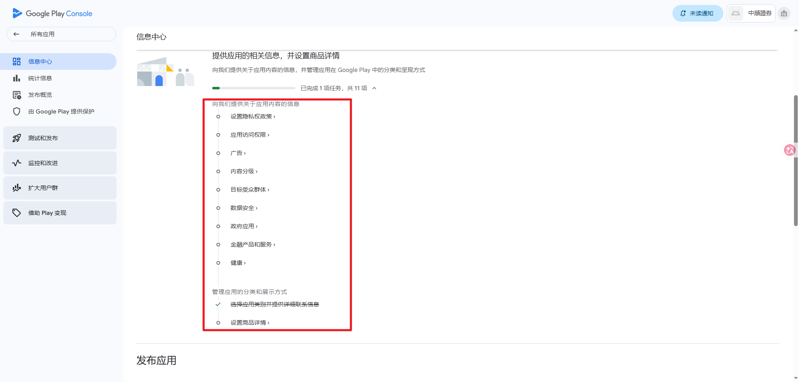
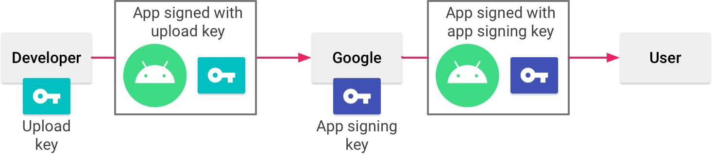
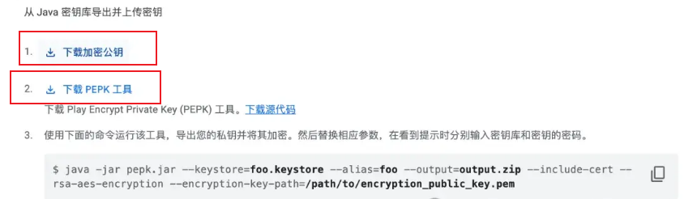
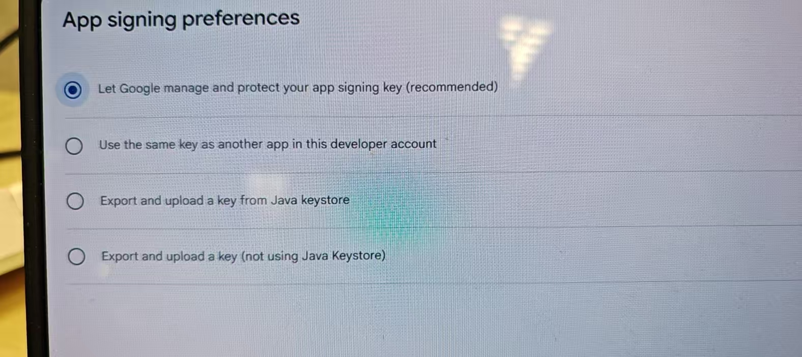
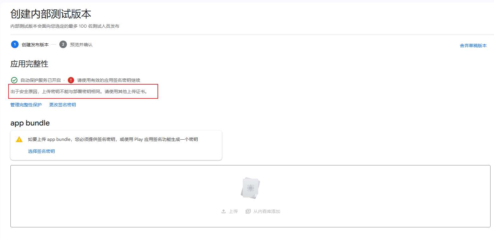

> **适用范围：** Android 应用首次上架 Google Play，以及后续测试版本、正式版本发布。

## 1. 流程总览

```text
获得开发者账号权限
        ↓
准备商店与合规资料
        ↓
生成并校验 AAB（处理签名）
        ↓
内部测试 / 封闭式测试 / 开放式测试
        ↓
正式版轨道提交审核
        ↓
审核通过并发布
```

建议发布路径为：**先封闭式测试验证上架包和核心功能，再按需要进行开放式测试，最后发布正式版。**

## 2. 上架前准备

### 2.1 开发者账号与权限

通常由客户或业务主体持有 Google Play 企业开发者账号，并向我方负责人的 Google 账号授予 Play Console 操作权限。应用、签名和商店资料均应归属业务主体，避免因人员变动造成账号资产无法交接。

个人账号与企业账号的差异如下：

| 项目 | 个人开发者账号 | 企业开发者账号 |
| --- | --- | --- |
| 前台开发者名称 | 个人法定名称 | 公司官方名称 |
| 团队协作 | 权限与交接能力有限 | 可分配多成员及不同权限 |
| 注册材料 | 身份证明、支付方式、联系方式 | 企业资质；通常需 D-U-N-S 等企业信息 |
| 发布要求 | 对测试及身份验证要求可能更严格 | 完成企业验证后更适合公司主体运营 |

> **注意：** Google Play 的资格、测试和政策要求会调整。实际发布前，应以 Play Console 当前提示及 Google 官方政策为准，不应只依赖本文中的历史经验。

### 2.2 商店与合规资料

在 Play Console 的“信息中心/商店设置”中准备并完善以下内容：

- 隐私政策链接；
- 应用名称、简短说明、完整说明；
- 应用图标、宣传图、手机截图及其他所需素材；
- 应用分类、联系信息、内容分级；
- 数据安全表单及其他政策声明。



资料不完整或表述与应用实际行为不一致，可能导致审核退回；以控制台给出的缺失项和审核反馈为准逐项补齐。

## 3. AAB 构建与签名

### 3.1 使用 AAB 产物

Google Play 上架新应用使用 Android App Bundle（`.aab`）产物，而不是日常分发常见的 APK。Android Studio 中可按以下路径构建：

1. 打开 **Build → Generate Signed Bundle / APK**；
2. 选择 **Android App Bundle**；
3. 配置签名信息；
4. 选择正确的 release 构建变体并执行构建；
5. 对生成的 AAB 完成安装、启动和关键业务流程校验后再上传。

### 3.2 区分两类签名密钥

Google Play App Signing 涉及两类密钥，**不得混用**：

| 密钥 | 用途 | 管理建议 |
| --- | --- | --- |
| 应用签名密钥（App signing key） | Google Play 最终用于签署分发给用户的 APK | 若应用还通过官网等渠道分发，为保持可覆盖安装，应规划并保留自有应用签名密钥 |
| 上传密钥（Upload key） | 对提交给 Google Play 的 AAB 进行身份校验 | 单独创建并妥善保管；每次上传 AAB 使用该密钥 |



如果应用还需要通过官网或其他渠道发布，选择自有应用签名密钥的方案，避免 Google Play 与外部渠道因签名不同而无法相互覆盖安装。将自有 Java keystore 密钥导入 Google Play 时，需要先在 Play Console 下载加密公钥，再使用 PEPK 对 keystore 加密并上传。

```shell
java -jar pepk.jar \
  --keystore=your_jks_file.jks \
  --alias=your_alias \
  --output=output.zip \
  --include-cert \
  --rsa-aes-encryption \
  --encryption-key-path=encryption_public_key.pem \
  --keystore-pass=your_pwd
```





> **安全要求：** 不要将 `.jks`、别名密码、keystore 密码或导出的密钥压缩包提交到代码仓库或附在 Confluence 页面中。密钥应保存于公司指定的受控密钥库，并明确备份与交接责任人。

## 4. 测试轨道发布

Play Console 提供内部测试、封闭式测试和开放式测试轨道。具体人数限制、审核要求和可用功能以控制台当前规则为准。

| 轨道 | 适用场景 | 测试者加入方式 | 发布建议 |
| --- | --- | --- | --- |
| 内部测试 | 开发与内部质量验证 | 指定 Google 账号/邀请链接 | 用于快速验证包体与基础功能 |
| 封闭式测试 | 小范围核心用户验证 | 邮箱名单或 Google 群组 | 建议作为正式发布前的必经验证环节 |
| 开放式测试 | 面向更广泛用户的公开测试 | 公开链接或商店入口 | 适合收集大范围反馈和公开评价 |

每次提交测试版本的标准步骤：

1. 确认 AAB 为 release 包，版本号与 versionCode 已递增；
2. 上传 AAB 并填写版本说明；
3. 完成控制台要求的合规声明；
4. 提交审核（封闭式和开放式测试通常需要）；
5. 审核通过后，使用目标测试轨道实际下载安装并回归关键功能。

## 5. 正式版发布

在测试版本稳定、商店资料和合规表单齐备后：

1. 进入**正式版（Production）**轨道，创建版本并上传已验证的 AAB；
2. 填写面向用户的更新说明，复核国家/地区、定价和发布范围；
3. 检查 Play Console 的所有待办、政策声明与警告；
4. 提交 Google Play 审核；
5. 审核通过后按计划立即发布或分阶段发布；
6. 发布后从商店安装验证，并持续关注崩溃、ANR、用户反馈和控制台告警。

正式版审核通常比测试轨道更严格。若被退回，应以审核邮件或 Play Console 的具体原因定位问题、修复后重新提交，并在页面中记录处理结果。

## 6. 常见问题与处理经验

### 6.1 上传签名与应用签名使用了同一把密钥

**现象：** 首次上传 AAB 时使用应用签名密钥进行签名，Google 可能将其识别为上传密钥；后续配置或上传时出现签名冲突提示。

**处理：**

1. 新建独立 keystore，作为上传密钥；后续 AAB 均用该上传密钥签名；
2. 在 Play Console 重置上传签名，登记新的上传密钥；
3. 若重置后仍异常，可按控制台允许的路径临时切换为 Google 管理应用签名，待状态生效后，再在“应用完整性 → 应用签名”中同时重新配置自有应用签名与上传签名；
4. 每一步均以控制台提示为准，并在执行前备份现有密钥与证书信息。



### 6.2 PEPK 导出私钥时报加密算法错误

**现象：** 执行 PEPK 命令时出现 `NoSuchAlgorithmException` 或无法导出/加密私钥。

**处理：** 检查执行命令的 JDK。历史处理经验是改用包含所需加密能力的 OpenJDK 21，并明确配置命令所使用的 JDK 后重试。不要仅凭修改命令参数绕过错误；应先确认 Java 版本、PEPK 版本及官方当前要求。

### 6.3 上传 debug 包或未正确签名的 AAB

**现象：** 控制台提示 AAB 未签名或无法上传。

**处理：** 确认上传的是 release 构建变体，并已使用独立的上传密钥完成签名。

## 7. 发布前检查清单

- [ ] 已获得业务主体 Play Console 的相应权限。
- [ ] 商店资料、隐私政策、数据安全和政策声明已完成并与应用实际一致。
- [ ] 上传的是已验证的 release AAB，且 versionCode 已递增。
- [ ] 应用签名密钥与上传密钥独立，密钥文件及密码均已受控保存。
- [ ] AAB 已完成安装、启动、登录、核心交易/业务流程及关键页面回归。
- [ ] 已在合适的测试轨道验证，并处理测试反馈。
- [ ] 正式版的地区、定价、更新说明、发布策略均已复核。
- [ ] 已明确审核失败的责任人、修复路径和再次提交计划。

## 8. 参考资料

- [Android App Bundle 简介](https://developer.android.com/guide/app-bundle?hl=zh-cn)
- [为应用签名](https://developer.android.com/studio/publish/app-signing?hl=zh-cn)