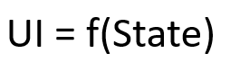

接触鸿蒙时记下的第一份笔记。从 HarmonyOS「一次开发、多端部署」的核心特性讲起，记录 Stage 模型下的工程结构（AppScope、module.json5 等配置分别放在哪里）、ArkTS 的语言特性与特殊语法，以及 ArkUI 声明式 UI 的基本写法。适合从 Android 转过来时对照理解。

## HarmonyOS 关键特性

[视频-HarmonyOS 关键特性](https://developer.huawei.com/consumer/cn/training/course/video/C101705589427300086)

万物互联时代，多端开发成为难点，HarmonyOS 主要就是为了解决这一问题，达成一次开发，多端部署的效果。

总结：

1. 应用开发的机遇、挑战和趋势

2. HarmonyOS核心技术理念:
    - 一次开发 多端部署
  - 可分可合 自由流转
  - 统一生态 原生智能
3. 高效开发与测试:ArkTS、ArkUI框架、开发/测试工具
4. 上架与分发

## HelloWorld

### 第一个 ArkTS 应用（Stage 模型）

主要介绍三个内容：

- 项目结构
  - 与原本 Android 中的结构很类似
    - 统一使用 json5 文件作为配置文件，将不同的配置分布在不同的文件夹
    - **AppScope > app.json5**：应用的全局配置信息。
    - **entry**：HarmonyOS工程模块，编译构建生成一个HAP包。
    - **src > main > module.json5**：Stage模型模块配置文件。主要包含HAP包的配置信息、应用/服务在具体设备上的配置信息以及应用/服务的全局配置信息。
    - **build-profile.json5**：当前的模块信息、编译信息配置项，包括buildOption、targets配置等。
    - **hvigorfile.ts**：模块级编译构建任务脚本，开发者可以自定义相关任务和代码实现。
    - **oh_modules**：用于存放三方库依赖信息。关于原npm工程适配ohpm操作，请参考[历史工程迁移](https://developer.harmonyos.com/cn/docs/documentation/doc-guides-V3/project_overview-0000001053822398-V3#section167081936119)。
    - **build-profile.json5**：应用级配置信息，包括签名、产品配置等。
    - **hvigorfile.ts**：应用级编译构建任务脚本。
- 页面创建
  - 声明式的页面创建
  - 预览器的使用
- 页面跳转
  - router 路由
  - 直接在相应 UI 控件后添加`.onClick()`方法添加点击事件
  

## ArkTS 语言

### 主要特性

- 聚焦于提高运行效率
- TypeScript 的进一步拓展，可复用 TS、JS 代码

### 特殊语法

1. Union 联合类型

2. 可选参数

   1. `testFunction(arg?: string) {...}` 中 `arg` 即为可选参数，如果不传参，默认值为 `undefined`

   2. `testFunction(arg: string = "test") {...}` 中同样为可选参数，不传参取默认值

3. rest 参数

   `function sum(...numbers: number[]): number {...}` 可表示之后可接受若干个 number 类型参数。

   但不能直接传入一个 number[]，如果需要传入，比如有一个 `let numbers = [1, 2, 3]`，需要以 `sum(...numbers)` 形式传参。

4. 箭头函数

5. 闭包

6. 对象字面量

7. 接口属性

8. 泛型默认值

9. 非空断言运算符 !

10. 空值合并运算符 ??

   类似 Kotlin 中的 `?:`，如果值为 undefined 或者 null，则返回右侧表达式

11. 可选链 ?.

    类似 Kotlin 中的 `?.`，如果值为 undefined 或者 null，则返回 undefined

## UI 范式基本语法

[官方文档](https://developer.huawei.com/consumer/cn/doc/harmonyos-guides-V5/arkts-create-custom-components-V5)

### 自定义组件

#### 基本用法

```typescript
@Component
struct HelloComponent {
  @State message: string = 'Hello, World!';

  build() {
    // HelloComponent自定义组件组合系统组件Row和Text
    Row() {
      Text(this.message)
        .onClick(() => {
          // 状态变量message的改变驱动UI刷新，UI从'Hello, World!'刷新为'Hello, ArkUI!'
          this.message = 'Hello, ArkUI!';
        })
    }
  }
}
```

#### 自定义组件基本结构

- struct 关键字

  自定义组件基于struct实现，struct + 自定义组件名 + {...}的组合构成自定义组件，不能有继承关系。对于struct的实例化，可以省略new。

  > [!NOTE]
  >
  > 自定义组件名、类名、函数名不能和系统组件名相同。

- `@Component`

  @Component装饰器仅能装饰struct关键字声明的数据结构。struct被@Component装饰后具备组件化的能力，需要实现build方法描述UI，一个struct只能被一个@Component装饰。

  ```typescript
  @Component
  struct MyComponent {
  }
  ```

- build()函数

  build()函数用于定义自定义组件的声明式UI描述，自定义组件必须定义build()函数。

  ```typescript
  @Component
  struct MyComponent {
      build() {
      }
  }
  ```

- `@Entry`

  @Entry装饰的自定义组件将作为UI页面的入口。在单个UI页面中，最多可以使用@Entry装饰一个自定义组件。@Entry可以接受一个可选的[LocalStorage](https://developer.huawei.com/consumer/cn/doc/harmonyos-guides-V5/arkts-localstorage-V5)的参数。

#### 成员函数/变量

自定义组件可以包含成员变量，成员变量具有以下约束：

- 自定义组件的成员变量为私有的，且不建议声明成静态变量。
- 自定义组件的成员变量本地初始化有些是可选的，有些是必选的。具体是否需要本地初始化，是否需要从父组件通过参数传递初始化子组件的成员变量，请参考[状态管理](https://developer.huawei.com/consumer/cn/doc/harmonyos-guides-V5/arkts-state-management-overview-V5)。

#### build()函数

所有声明在build()函数的语句，我们统称为UI描述，UI描述需要遵循以下规则：

- @Entry装饰的自定义组件，其build()函数下的根节点唯一且必要，且必须为容器组件，其中ForEach禁止作为根节点。

- @Component装饰的自定义组件，其build()函数下的根节点唯一且必要，可以为非容器组件，其中ForEach禁止作为根节点。

  ```typescript
  @Entry
  @Component
  struct MyComponent {
    build() {
      // 根节点唯一且必要，必须为容器组件
      Row() {
        ChildComponent() 
      }
    }
  }
  
  @Component
  struct ChildComponent {
    build() {
      // 根节点唯一且必要，可为非容器组件
      Image('test.jpg')
    }
  }
  ```

- 不允许声明本地变量，反例如下。

  ```typescript
  build() {
    // 反例：不允许声明本地变量
    let a: number = 1;
  }
  ```

- 不允许在UI描述里直接使用console.info，但允许在方法或者函数里使用，反例如下。

  ```typescript
  build() {
    // 反例：不允许console.info
    console.info('print debug log');
  }
  ```

- 不允许调用没有用@Builder装饰的方法，允许系统组件的参数是TS方法的返回值。

  ```typescript
  @Component
  struct ParentComponent {
    doSomeCalculations() {
    }
  
    calcTextValue(): string {
      return 'Hello World';
    }
  
    @Builder doSomeRender() {
      Text(`Hello World`)
    }
  
    build() {
      Column() {
        // 反例：不能调用没有用@Builder装饰的方法
        this.doSomeCalculations();
        // 正例：可以调用
        this.doSomeRender();
        // 正例：参数可以为调用TS方法的返回值
        Text(this.calcTextValue())
      }
    }
  }
  ```

- 不允许使用switch语法，如果需要使用条件判断，请使用if。示例如下。

  ```typescript
  build() {
    Column() {
      // 反例：不允许使用switch语法
      switch (expression) {
        case 1:
          Text('...')
          break;
        case 2:
          Image('...')
          break;
        default:
          Text('...')
          break;
      }
      // 正例：使用if
      if(expression == 1) {
        Text('...')
      } else if(expression == 2) {
        Image('...')
      } else {
        Text('...')
      }
    }
  }
  ```

  

- 不允许使用表达式，反例如下。

  ```typescript
  build() {
    Column() {
      // 反例：不允许使用表达式
      (this.aVar > 10) ? Text('...') : Image('...')
    }
  }
  ```

- 不允许直接改变状态变量，反例如下。

  ```typescript
  @Component
  struct CompA {
    @State col1: Color = Color.Yellow;
    @State col2: Color = Color.Green;
    @State count: number = 1;
    build() {
      Column() {
        // 应避免直接在Text组件内改变count的值
        Text(`${this.count++}`)
          .width(50)
          .height(50)
          .fontColor(this.col1)
          .onClick(() => {
            this.col2 = Color.Red;
          })
        Button("change col1").onClick(() =>{
          this.col1 = Color.Pink;
        })
      }
      .backgroundColor(this.col2)
    }
  }
  ```

#### 状态驱动更新!

在ArkUI状态管理中，状态驱动UI更新。



- 所以，不能在自定义组件的build()或@Builder方法里直接改变状态变量，这可能会造成循环渲染的风险。Text('${this.count++}')在全量更新或最小化更新会产生不同的影响：

  - 全量更新（API8及以前版本）： ArkUI可能会陷入一个无限的重渲染的循环里，因为Text组件的每一次渲染都会改变应用的状态，就会再引起下一轮渲染的开启。 当 this.col2 更改时，都会执行整个build构建函数，因此，Text(\${this.count++})绑定的文本也会更改，每次重新渲染Text(${this.count++})，又会使this.count状态变量更新，导致新一轮的build执行，从而陷入无限循环。
  - 最小化更新（API9-至今版本）： 当 this.col2 更改时，只有Column组件会更新，Text组件不会更改。 只当 this.col1 更改时，会去更新整个Text组件，其所有属性函数都会执行，所以会看到Text(${this.count++})自增。因为目前UI以组件为单位进行更新，如果组件上某一个属性发生改变，会更新整体的组件。所以整体的更新链路是：this.col1 = Color.Pink -> Text组件整体更新->this.count++ ->Text组件整体更新。值得注意的是，这种写法在初次渲染时会导致Text组件渲染两次，从而对性能产生影响。

  build函数中更改应用状态的行为可能会比上面的示例更加隐蔽，比如：

  - 在@Builder，@Extend或@Styles方法内改变状态变量 。

  - 在计算参数时调用函数中改变应用状态变量，例如 Text('${this.calcLabel()}')。

  - 对当前数组做出修改，sort()改变了数组this.arr，随后的filter方法会返回一个新的数组。

    ```typescript
    // 反例
    @State arr : Array<...> = [ ... ];
    ForEach(this.arr.sort().filter(...), 
      item => { 
      ...
    })
    // 正确的执行方式为：filter返回一个新数组，后面的sort方法才不会改变原数组this.arr
    ForEach(this.arr.filter(...).sort(), 
      item => { 
      ...
    })
    ```
